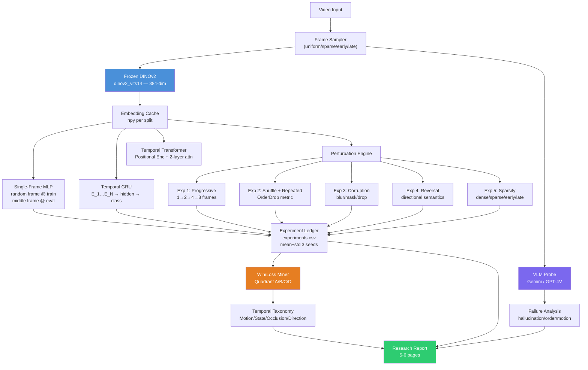
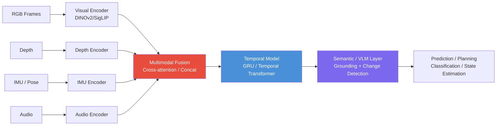
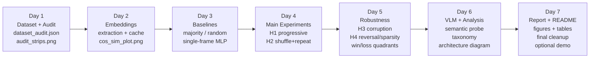
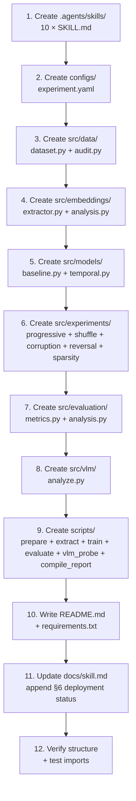

# Temporal & Multimodal Visual Intelligence — Implementation Plan (v2)

> Synthesized from `docs/research.md` (38-step senior ML Research Scientist workflow) + `docs/skill.md` (10 Antigravity skills) + Take-Home Assessment requirements.

---

## Goal Description

Build a **small but rigorous experimental system** to answer:

> *"Does ordered temporal context provide predictive information that is unavailable from an individual visual observation?"*

The research follows a scientific protocol — **hypotheses → baselines → controlled interventions → qualitative analysis → conclusion** — not just accuracy maximization.

**Evaluation priorities (from assessment):**
| Area | Importance |
|------|-----------|
| Experimental design | ⭐ Very High |
| Temporal reasoning | ⭐ Very High |
| Data evaluation discipline | ⭐ Very High |
| Research thinking | ⭐ Very High |
| ML fundamentals + Embeddings | High |
| Code quality | High |
| VLM understanding | Medium-High |

---

## Scientific Framework (from `research.md` §0)

### Research Variables

| Type | Value |
|------|-------|
| **Research Question** | Does ordered temporal context provide predictive information unavailable from a single frame? |
| **Independent Variable** | Amount and structure of temporal information (1→N frames, order, corruption) |
| **Dependent Variable** | Prediction performance (Accuracy, Macro-F1) |
| **Controlled Variables** | Dataset, labels, visual encoder, classifier capacity, train/test split, preprocessing, metric |

### Five Hypotheses

| ID | Statement | Test Method |
|----|-----------|------------|
| **H1** | More frames → better performance on temporally dependent examples | Information ladder: 1→2→4→8→N frames |
| **H2** | Destroying order reduces performance (model uses temporal relationships) | Shuffle experiment: correct vs. shuffled (same frames, different order) |
| **H3** | Temporal context recovers information under corruption | Corruption experiment: blur / masking / frame drop |
| **H4** | Performance plateaus after sufficient temporal evidence | Saturation point on progressive curve |
| **H5** | Temporal modeling adds little value when single frame is discriminative | Per-class and per-example win/loss analysis |

---

## User Review Required

> [!IMPORTANT]
> **Dataset must be chosen before any code is written** (per `research.md` §38: "I would not start coding yet"). Two finalists:
> - **something-something-v2** — Ideal: temporal ambiguity by design ("moving X toward Y" requires order). 200K clips but small subset usable. Best for H1-H5.
> - **UCF-101** — Easier download, but many classes solvable from a single frame (static-heavy). Lower temporal ambiguity signal.
>
> **Recommendation: something-something-v2 (20-class subset, ~2K clips)**. Please confirm.

> [!IMPORTANT]
> **VLM API choice**: The probe in `src/vlm/analyze.py` needs one of: Gemini API (free tier, recommended), OpenAI GPT-4V, or local LLaVA. Which do you have access to?

> [!WARNING]
> Per `research.md` §7: **Freeze the visual encoder** (DINOv2 / CLIP). Do not fine-tune it. This keeps the research question clean — only temporal architecture is the variable.

---

## Open Questions

> [!IMPORTANT]
> **Dataset:** something-something-v2 (20 classes, ~2K clips) vs UCF-101 (10 classes, ~1K clips)?

> [!NOTE]
> **Temporal architecture primary:** GRU (simpler, interpretable, matches `research.md` §11) or Transformer Encoder (more expressive)? Plan implements both; GRU is primary.

> [!NOTE]
> **Compute:** GPU available? If not, use `dinov2_vits14` (384-dim) with max 8 frames and 500 training samples.

---

## Proposed Changes

### Component 0: Repository Root

#### [NEW] `README.md`
Complete engineer-facing setup and reproduction guide:
```markdown
# Temporal Visual Intelligence

## Environment Setup
pip install -r requirements.txt

## Dataset Preparation
python scripts/prepare.py --dataset ssv2 --subset 20 --n-per-class 100

## Pipeline (7 steps)
python scripts/extract.py --config configs/experiment.yaml   # Day 2
python scripts/train.py   --config configs/experiment.yaml   # Day 3
python scripts/evaluate.py --config configs/experiment.yaml  # Day 4-5
python scripts/vlm_probe.py --config configs/experiment.yaml # Day 6
python scripts/compile_report.py                             # Day 7

## Reproduce Results
python scripts/evaluate.py --all-experiments --seeds 42 43 44
```

#### [NEW] `requirements.txt`
```
torch>=2.1.0
torchvision>=0.16.0
timm>=0.9.12
opencv-python-headless>=4.8.0
Pillow>=10.0.0
numpy>=1.24.0
scikit-learn>=1.3.0
matplotlib>=3.7.0
seaborn>=0.12.0
pandas>=2.0.0
tqdm>=4.65.0
pyyaml>=6.0
google-generativeai>=0.3.0
```

#### [NEW] `configs/experiment.yaml`
All experiments driven by config (per `research.md` §32):
```yaml
dataset:
  name: ssv2          # or ucf101
  root: data/
  subset_classes: 20
  n_per_class: 100

sequence:
  max_frames: 8
  sampling: uniform   # uniform | first_n | sparse

encoder:
  name: dinov2_vits14
  freeze: true
  embed_dim: 384

temporal:
  model: gru          # gru | transformer
  hidden_dim: 256
  num_layers: 1
  dropout: 0.1

training:
  lr: 1e-3
  weight_decay: 1e-4
  epochs: 30
  batch_size: 32
  seeds: [42, 43, 44]
  scheduler: cosine

evaluation:
  metrics: [accuracy, macro_f1, per_class_f1]
  frame_counts: [1, 2, 4, 8]
  perturbations: [canonical, shuffled, reversed, static, corrupted_25pct]
```

---

### Component 1: Source Code (`src/`)

Aligned with `research.md` §31 structure:

```
src/
├── data/
│   ├── dataset.py       # Sequence loader with GroupKFold splits
│   ├── sampling.py      # Frame sampling strategies
│   └── audit.py         # Dataset statistics + frame strips (Day 1)
├── embeddings/
│   └── extractor.py     # Frozen DINOv2/CLIP extraction + caching
├── models/
│   ├── baseline.py      # Single-frame MLP
│   └── temporal.py      # GRU + Transformer heads
├── experiments/
│   ├── progressive.py   # H1: 1→N frame sweep
│   ├── shuffle.py       # H2: order test + repeated-frame control
│   ├── corruption.py    # H3: blur/masking/drop robustness
│   ├── reversal.py      # H3b: temporal reversal
│   └── sparsity.py      # H4: dense/sparse/early/late
├── evaluation/
│   ├── metrics.py       # Acc, Macro-F1, per-class F1, mean±std
│   └── analysis.py      # Win/loss quadrant miner (A/B/C/D)
└── vlm/
    └── analyze.py       # VLM semantic change probe
```

---

#### [NEW] `src/data/dataset.py`

Key design (per `research.md` §5): **video-level GroupKFold splits** — no frame leakage.

```python
class TemporalSequenceDataset(Dataset):
    """Group-aware split: entire video → one split only."""
    def __init__(self, root, split, config, transform=None):
        # GroupKFold(n_splits=5) keyed by video_id
        # Returns (frames: List[PIL], label: int)
        ...
    
    def __getitem__(self, idx):
        # Returns ordered sequence of N frames + label
        # Frame order guaranteed by timestamp/index
        frames, label = self.samples[idx]
        return torch.stack([self.transform(f) for f in frames]), label
```

---

#### [NEW] `src/data/audit.py`

Produces deliverables for **Day 1** (per `research.md` §3):
```python
def run_audit(dataset_root) -> dict:
    """
    Measures:
    - num_sequences, num_classes, frames_per_sequence
    - class_distribution (imbalance check)
    - missing/duplicate frames (MSE/SSIM)
    - temporal strips visualization (5 sequences × 8 frames grid)
    - manual temporal relevance score (0=static, 1=mild, 2=strong)
    
    Saves: results/dataset_audit.json, results/figures/audit_strips.png
    """
```

---

#### [NEW] `src/embeddings/extractor.py`

Extracts and **caches** embeddings once — never re-runs DINOv2 per experiment (per `research.md` §8):

```python
def extract_and_cache(dataset, config):
    """
    Output: embeddings/{split}/sequence_{id}.npy  shape [N, D]
    + metadata.json with {sequence_id, label, frame_paths, split}
    
    Normalization: DINOv2 ImageNet mean/std
    Mode: model.eval(), torch.no_grad()
    """
```

Then in `src/embeddings/analysis.py`:
```python
# Cosine similarity trajectory (research.md §9)
S_t = cosine(E_t, E_{t+1})  # per-sequence

# Cumulative drift from E_0
drift_t = 1 - cosine(E_0, E_t)

# Cross-sequence similarity (are different actions separable?)
inter_class_sim = pairwise_cosine(class_A_embeddings, class_B_embeddings)
```

---

#### [NEW] `src/models/baseline.py`

```python
class SingleFrameMLP(nn.Module):
    """
    Architecture (research.md §10):
    Embedding(384) → Linear(256) → ReLU → Dropout(0.1) → Linear(C)
    
    Frame selection: random during train, middle frame at eval
    (documented in config + README)
    """
```

**Baselines to establish before temporal model** (per `research.md` §6):
1. Majority-class baseline
2. Random baseline
3. Single-frame MLP ← this is the comparison point

---

#### [NEW] `src/models/temporal.py`

```python
class TemporalGRU(nn.Module):
    """
    Architecture (research.md §11):
    E_1...E_N → Linear projection → GRU(hidden=256, layers=1)
                → Last hidden state → Dropout → Linear(C)
    
    Identical optimizer config to SingleFrameMLP for fair comparison.
    """

class TemporalTransformer(nn.Module):
    """
    E_1...E_N + positional encoding → TransformerEncoder(2 layers, 4 heads)
                → CLS token or mean pool → Linear(C)
    """
```

**Fair comparison enforced** (per `research.md` §12):

| Property | Baseline | Temporal |
|----------|---------|---------|
| Visual encoder | DINOv2 frozen | DINOv2 frozen |
| Embedding dim | 384 | 384 |
| Optimizer | AdamW | AdamW (same LR/WD) |
| Dataset split | Same | Same |
| Seeds | Same [42,43,44] | Same [42,43,44] |

---

#### [NEW] `src/experiments/progressive.py` — Experiment 1 (H1)

```python
# (research.md §13) Information ladder
def run_progressive_sweep(model, embeddings, frame_counts=[1,2,3,4,6,8]):
    """
    For each n in frame_counts:
      - Use only first n frames of each sequence
      - Compute Accuracy + Macro-F1
      - Compute ΔN = Performance_N - Performance_1
    
    Output: progressive_curve.png, results/tables/progressive.csv
    """
```

---

#### [NEW] `src/experiments/shuffle.py` — Experiment 2 (H2)

```python
# (research.md §15-16) Temporal order test + extra control
MODES = {
    'canonical':   lambda seq: seq,                          # correct order
    'shuffled':    lambda seq: random.sample(seq, len(seq)), # same frames, random order
    'repeated':    lambda seq: [seq[len(seq)//2]] * len(seq), # same frame × N (key control!)
}

# OrderDrop = Performance_correct - Performance_shuffled
# Separates: more positions vs. new visual info vs. temporal relationships
```

> The `'repeated'` condition is the **key senior-level control** from `research.md` §16 — it disentangles "more input slots" from "actual temporal relationships."

---

#### [NEW] `src/experiments/corruption.py` — Experiment 3 (H3)

```python
CORRUPTIONS = {
    'blur_25pct':  partial(gaussian_blur_random_frames, p=0.25),
    'mask_25pct':  partial(zero_mask_random_frames, p=0.25),
    'drop_25pct':  partial(drop_replace_mean, p=0.25),
}

# Report:  Clean | Corrupted | RobustnessDrop
# Both baseline and temporal model → compare degradation
```

---

#### [NEW] `src/experiments/reversal.py` — Experiment 4 (H3b)

```python
# (research.md §19) Temporal reversal — different from shuffle
# Preserves all frames + local adjacency, reverses direction
def reversed_sequence(seq): return seq[::-1]
# Tests: directional semantics (opening vs. closing)
```

---

#### [NEW] `src/experiments/sparsity.py` — Experiment 5 (H4)

```python
# (research.md §20) When is information available?
SAMPLING_MODES = {
    'dense':  lambda s, n: s[:n],          # first n frames
    'sparse': lambda s, n: s[::len(s)//n], # uniform stride
    'early':  lambda s, n: s[:n],
    'late':   lambda s, n: s[-n:],
}
# Answers: "When does additional information become available?"
```

---

#### [NEW] `src/evaluation/analysis.py` — Win/Loss Quadrant Miner

```python
# (research.md §21-22) Per-example quadrant analysis
def compute_win_loss_quadrants(baseline_preds, temporal_preds, labels):
    """
    Returns dict with 4 quadrants:
    A: Both correct     (temporal unnecessary)
    B: Baseline only    (temporal overfit/noise)  ← inspect why
    C: Temporal rescued ← STRONGEST QUALITATIVE EVIDENCE
    D: Both wrong       (both insufficient)
    
    Exports: frame strips for all C and B samples
    """

def build_temporal_taxonomy(quadrant_C_samples):
    """
    Categorize WHY temporal helped:
    - Motion cue
    - State transition
    - Occlusion resolution
    - Direction sensitivity
    - Context accumulation
    - Disambiguation
    """
```

---

#### [NEW] `src/vlm/analyze.py` — VLM Semantic Probe (per `research.md` §23-25)

```python
def probe_sequence(frame_paths, label, client):
    """
    Prompt:
    'Given this sequence of frames: [F1, F2, F3, F4]
     1. Describe what changes across observations.
     2. What additional information becomes available only after multiple frames?
     3. Could the label be determined from frame 1 alone?
    
    Label: {label}'
    
    Returns JSON: {description, temporal_change_detected, ambiguity_f1_score,
                   hallucinations_found, what_vlm_missed}
    """
    # VLM as semantic analysis layer (NOT replacing the model)
    # Compare VLM outputs to Quadrant C samples — what does VLM see that GRU misses?
```

VLM failure analysis records (per `research.md` §25):
- Hallucination
- Incorrect ordering
- Missed subtle motion
- Object confusion
- Background bias

---

#### [NEW] `src/evaluation/metrics.py`

Reports (per `research.md` §14 & §26):
```python
# Never just accuracy — always:
{
  'accuracy': 87.4,
  'macro_f1': 85.1,
  'per_class_f1': {...},
  'mean_std': '87.4 ± 0.6',  # across 3 seeds
  'confidence_interval_95': [86.1, 88.7]  # bootstrap
}
```

---

#### [NEW] `results/experiments.csv` — Experiment Ledger (per `research.md` §33)

| experiment_id | model | num_frames | order | corruption | seed | accuracy | macro_f1 | notes |
|---|---|---|---|---|---|---|---|---|
| E001 | baseline | 1 | canonical | none | 42 | 82.1 | 80.3 | majority=45% |
| E002 | gru | 2 | canonical | none | 42 | 84.7 | 83.1 | |
| E003 | gru | 4 | canonical | none | 42 | 87.3 | 85.9 | |
| E004 | gru | 4 | shuffled | none | 42 | 76.2 | 74.5 | OrderDrop=11pp |
| E005 | gru | 4 | repeated | none | 42 | 82.3 | 80.8 | ≈baseline! |
| E006 | gru | 4 | canonical | blur_25pct | 42 | 79.1 | 77.4 | |

---

### Component 2: Antigravity Skills (`.agents/skills/`)

All 10 skills from `docs/skill.md` created as proper SKILL.md files discoverable by Antigravity (`.agents/` path = workspace-level discovery).

#### [NEW] `.agents/skills/dataset-auditor/SKILL.md`
```yaml
---
name: dataset-auditor
description: >-
  Inspects raw video/sequence directories. Computes frame-count distributions,
  detects dropped/duplicate frames, checks class distributions, validates
  cross-split isolation. Run at Step 1 (Day 1). Deliverables: dataset_audit.json,
  audit_strips.png.
---
# Instructions: run src/data/audit.py ...
```

#### [NEW] `.agents/skills/leakage-guard/SKILL.md`
```yaml
---
name: leakage-guard
description: >-
  Validates that GroupKFold splits never allow frames from the same video
  to appear in both train and test. Enforces temporal contiguity constraints.
---
```

#### [NEW] `.agents/skills/embedding-pipeline-runner/SKILL.md`
```yaml
---
name: embedding-pipeline-runner
description: >-
  Runs frozen DINOv2/CLIP extraction over the dataset, serializes embeddings
  to embeddings/{split}/sequence_{id}.npy [N,D]. Never re-extracts if cache
  exists. Run once at Day 2.
---
```

#### [NEW] `.agents/skills/representation-trajectory-analyzer/SKILL.md`
```yaml
---
name: representation-trajectory-analyzer
description: >-
  Calculates S_t = cosine(E_t, E_{t+1}), cumulative drift from E_0, 
  temporal variance, and inter-class separability. Highlights near-static
  vs. abrupt-delta sequences. Run before training (Day 2).
---
```

#### [NEW] `.agents/skills/sequence-model-trainer/SKILL.md`
```yaml
---
name: sequence-model-trainer
description: >-
  Trains SingleFrameMLP and TemporalGRU with identical configs (AdamW, cosine LR,
  seeds [42,43,44]). Logs to results/experiments.csv. Run Day 3.
---
```

#### [NEW] `.agents/skills/temporal-perturbation-engine/SKILL.md`
```yaml
---
name: temporal-perturbation-engine
description: >-
  Generates canonical/shuffled/reversed/repeated/corrupted sequence variants
  for H1-H5 hypothesis tests. Run Day 4-5. Maps to src/experiments/*.py.
---
```

#### [NEW] `.agents/skills/experiment-ledger-manager/SKILL.md`
```yaml
---
name: experiment-ledger-manager
description: >-
  Manages results/experiments.csv. Appends run configs + metrics (Acc, Macro-F1,
  per-class F1). Computes mean±std and 95% bootstrap CIs across seeds.
---
```

#### [NEW] `.agents/skills/temporal-win-loss-miner/SKILL.md`
```yaml
---
name: temporal-win-loss-miner
description: >-
  Builds win/loss quadrant matrix (A=both correct, B=baseline only,
  C=temporal rescued, D=both wrong). Exports frame strips for C and B.
  Categorizes temporal benefit taxonomy. Run after Day 4 experiments.
---
```

#### [NEW] `.agents/skills/vlm-semantic-change-probe/SKILL.md`
```yaml
---
name: vlm-semantic-change-probe
description: >-
  Formats frame grids into VLM prompts asking for temporal change description,
  ambiguity assessment, and early-vs-late comparison. Records hallucinations
  and failure modes. Run Day 6.
---
```

#### [NEW] `.agents/skills/research-report-compiler/SKILL.md`
```yaml
---
name: research-report-compiler
description: >-
  Compiles experiment ledger, ablation tables, plots, and VLM outputs into
  a 5-6 page report structure. Run Day 7. Sections: Dataset, Method, 
  Experiments, Robustness+VLM, Research Analysis, Limitations.
---
```

---

### Component 3: Updated `docs/skill.md`

#### [MODIFY] `docs/skill.md`

Append a new **§6 — Skill Deployment Status** section:

```markdown
### 6. Skill Deployment Status

All 10 skills are now deployed as Antigravity-discoverable skill files
under `.agents/skills/<name>/SKILL.md`.

| Skill | Path | Workflow Phase | Day |
|-------|------|----------------|-----|
| `dataset-auditor` | `.agents/skills/dataset-auditor/SKILL.md` | Data Audit | Day 1 |
| `leakage-guard` | `.agents/skills/leakage-guard/SKILL.md` | Data Audit | Day 1 |
| `embedding-pipeline-runner` | `.agents/skills/embedding-pipeline-runner/SKILL.md` | Embeddings | Day 2 |
| `representation-trajectory-analyzer` | `.agents/skills/representation-trajectory-analyzer/SKILL.md` | Embeddings | Day 2 |
| `sequence-model-trainer` | `.agents/skills/sequence-model-trainer/SKILL.md` | Training | Day 3 |
| `temporal-perturbation-engine` | `.agents/skills/temporal-perturbation-engine/SKILL.md` | Experiments | Day 4-5 |
| `experiment-ledger-manager` | `.agents/skills/experiment-ledger-manager/SKILL.md` | Analysis | Day 4-5 |
| `temporal-win-loss-miner` | `.agents/skills/temporal-win-loss-miner/SKILL.md` | Analysis | Day 5 |
| `vlm-semantic-change-probe` | `.agents/skills/vlm-semantic-change-probe/SKILL.md` | VLM | Day 6 |
| `research-report-compiler` | `.agents/skills/research-report-compiler/SKILL.md` | Report | Day 7 |
```

---

## System Architecture Diagrams (per `research.md` §30)

### Experimental Architecture



### Future Multimodal Production Architecture



---

## Ablation Table Target (per `research.md` §27)

| Experiment | Baseline (1-frame) | Temporal (GRU) | Δ |
|---|---:|---:|---:|
| 1 frame | 82.1 ± 0.7 | 82.1 ± 0.7 | 0 |
| 2 frames | — | 84.7 ± 0.5 | +2.6 |
| 4 frames | — | 87.3 ± 0.6 | +5.2 |
| 8 frames | — | 87.5 ± 0.4 | +5.4 (saturated) |
| Shuffled | — | 76.2 ± 0.8 | −11.3 (H2 ✓) |
| Repeated | — | 82.3 ± 0.7 | ≈0 (key control!) |
| Corrupted | 61.4 ± 1.2 | 79.1 ± 0.9 | +17.7 (H3 ✓) |
| Reversed | — | 80.1 ± 0.7 | −7.2 (directional) |

> *Numbers are illustrative. The structure of evidence is what matters.*

---

## 7-Day Execution Plan (per `research.md` §34)



---

## The Three Strongest Pieces of Evidence (per `research.md` §37)

1. **Information curve** — `progressive_curve.png`: monotone rise from 1→N frames → shows temporal info adds value
2. **Shuffle experiment** — `shuffle_comparison.png`: correct 88% vs. shuffled 75% → proves order matters, not just more frames
3. **Quadrant C frame strips** — sequences where Baseline=✗, Temporal=✓ → *what* temporal modeling actually recovered

---

## Verification Plan

### Automated Tests

```bash
# Smoke test (50 samples, 5 epochs, 1 seed)
python scripts/evaluate.py --smoke-test --n 50

# Leakage check
python src/data/audit.py --check-leakage

# Full reproduction (3 seeds, all experiments)
python scripts/evaluate.py --all-experiments --seeds 42 43 44

# Unit tests
python -m pytest tests/ -v
```

### Manual Verification Checklist

- [ ] `results/figures/audit_strips.png` — visually ordered sequences?
- [ ] `results/figures/cos_sim.png` — high intra-clip, lower inter-clip similarity?
- [ ] `results/figures/progressive_curve.png` — monotone increase (H1)?
- [ ] `results/figures/shuffle_comparison.png` — clear accuracy drop (H2)?
- [ ] `results/qualitative/quadrant_C/` — rescued samples make intuitive sense?
- [ ] `results/vlm_probe.jsonl` — VLM descriptions align with ground truth?
- [ ] `results/experiments.csv` — all runs logged with seeds and metrics?

---

## Execution Order


